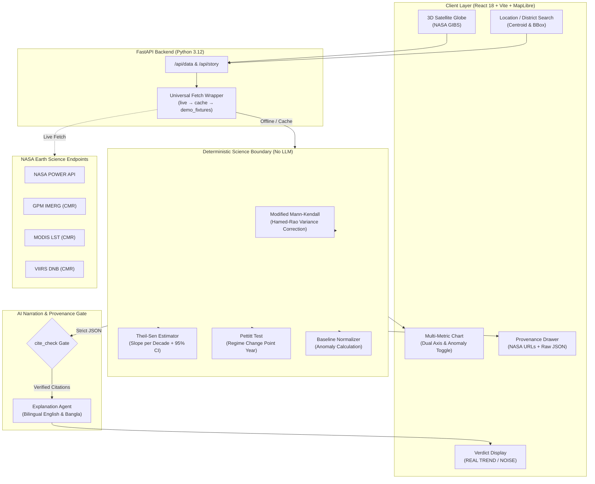

# Hritu: Trend or Noise? (হৃতু)

[](https://www.spaceappschallenge.org/)
[](https://www.spaceappschallenge.org/)
[](https://hritu-xi.vercel.app/)
[](LICENSE)
[](demo_fixtures/)

> **"Is this seasonal shift real, or is it just noise?"**  
> *Hritu* (Bengali for *Season*) is an offline-first Earth System Trend Detective built for Bangladesh and scalable globally. It bridges over 45 years of NASA satellite observations with autocorrelation-corrected statistical physics to separate genuine climate regime shifts from short-term stochastic noise.

🌐 **Production Deployment:** [https://hritu-xi.vercel.app/](https://hritu-xi.vercel.app/)  
📁 **Public Repository:** [https://github.com/shahriarkhansakib/Hritu](https://github.com/shahriarkhansakib/Hritu)  
📄 **AI Disclosure & Compliance:** [docs/AI_USE.md](docs/AI_USE.md)

---

## 📑 Table of Contents
1. [The Problem & The Bangladesh Context](#-the-problem--the-bangladesh-context)
2. [The Core Innovation: Trend Detective Engine](#-the-core-innovation-trend-detective-engine)
3. [The 5 Human Lenses (Bangladesh Stories)](#-the-5-human-lenses-bangladesh-stories)
4. [NASA Earth Observation Datasets Used](#-nasa-earth-observation-datasets-used)
5. [Multi-Metric Visualization & Anomaly Engine](#-multi-metric-visualization--anomaly-engine)
6. [Full Technical Stack](#-full-technical-stack)
7. [System Architecture](#-system-architecture)
8. [NASA Space Apps Judging Criteria Alignment](#-nasa-space-apps-judging-criteria-alignment)
9. [AI Disclosure & Provenance Gate](#-ai-disclosure--provenance-gate)
10. [Local Development & Offline Rehearsal](#-local-development--offline-rehearsal)
11. [License & Disclaimers](#-license--disclaimers)

---

## 🌍 The Problem & The Bangladesh Context

Bangladesh sits at the hydrodynamic funnel of the Bay of Bengal, where seasonal rhythms dictate agriculture, urban planning, disaster mitigation, and economic survival:
- A farmer in **Sylhet** or **Rangpur** asks: *"Why are the Asharh monsoon rains arriving 10 days late?"*
- A citizen in **Dhaka** feels unlivable nighttime heat and wonders: *"Is nighttime temperature actually rising, or is it urban density?"*
- A winter traveler in **Rajshahi** notes: *"Where did the bitter cold weeks of December go?"*

### The Scientific Challenge
Human memory is subjective, and standard climate line graphs can be deeply misleading:
1. **Unit Collision:** Plotting temperature (°C) and precipitation (mm) on a shared axis produces unreadable, flattened curves with zero comparative insight.
2. **Serial Autocorrelation False Positives:** Daily and monthly climate time series have high Lag-1 autocorrelation. Standard Ordinary Least Squares (OLS) or standard Mann-Kendall tests assume independent, identically distributed (I.I.D.) data. Applying standard regression to autocorrelated climate data inflates variance and creates **false positive trends**.
3. **Hallucination Risk:** Generative AI tools often fabricate numerical trends and blur causation with correlation.

**Hritu solves this deterministically.**

---

## 🔬 The Core Innovation: Trend Detective Engine

Hritu refuses to guess. All statistical calculations are isolated in pure Python (`src/compute/trend.py`) with zero LLM computation.

```
Raw NASA Observations ──► Serial Autocorrelation Correction ──► Theil-Sen Robust Slope ──► Pettitt Change-Point ──► Deterministic Verdict
(POWER / IMERG / MODIS)       (Hamed & Rao Modified MK)             (Change / Decade)           (Regime Shift Year)      [REAL | WEAK | NOISE]
```

### 1. Modified Mann-Kendall Test (Hamed & Rao 1998)
Instead of naive linear fits, Hritu calculates the rank-based Mann-Kendall test statistic $S$ and applies the Hamed & Rao variance correction factor $n/S^*$ based on empirical lag autocorrelation coefficients, preventing false climate alarms ($p < 0.05$ threshold).

### 2. Theil-Sen Robust Slope Estimation
Calculates median slope across all pairwise point combinations, impervious to extreme climate anomalies (like cyclone cloudbursts) and computes non-parametric 95% confidence intervals ($\text{slope per decade}$).

### 3. Pettitt Change-Point Detection
Identifies the exact breakpoint year $\tau$ when the seasonal distribution shifted from historical normal to a new baseline regime (e.g., pinpointing the year Rajshahi's winter cold pool broke).

### 4. The 3 Deterministic Verdicts
- 🔴 **REAL TREND** — $p < 0.05$ (Statistically significant monotonic climate shift)
- 🟡 **WEAK SIGNAL** — Directional tendency present, but $p \ge 0.05$ (stochastic noise cannot be ruled out)
- ⚪ **NOISE** — No statistically detectable trend; seasonal variation remains within natural historical bounds

---

## 📖 The 5 Human Lenses (Bangladesh Stories)

| # | Story Lens | Persona & Target Question | Primary NASA Data | Computed Metric |
|---|---|---|---|---|
| 1 | **🥶 The Winter Vacationer** | *The Missing Cold in Northern BD:* Has Rajshahi's cold season statistically collapsed? | **NASA POWER** `T2M_MIN` (1981–2026) | Annual count of days $\le 14^\circ\text{C}$ in Dec 20 – Jan 5 window |
| 2 | **🌧️ The Rain-Lover** | *The Delayed Monsoon:* Are Asharh rains arriving later across the northwestern agricultural belt? | **GPM IMERG Final V07** (2000–2026) | Day-of-Year (DOY) of first 7-day rolling window $> 25\text{ mm/day}$ without dry spell break |
| 3 | **🏡 The Retirement Relocator** | *Microclimate Scout:* Which of Bangladesh's 64 districts offers the most resilient climate trend? | **NASA POWER** `T2M_MAX`, `RH2M`, `PRECTOTCORR` | Multi-district Heat Index trend ranking (Rothfusz equation) |
| 4 | **🏙️ The Urban Planner** | *Dhaka Heat vs. Lights:* Does urban spatial expansion causally track land surface heating? | **MODIS MOD11A2** + **VIIRS Day/Night Band** | Pixel-by-pixel spatial correlation of LST slope vs nightlight radiance slope (2012–2025) |
| 5 | **🌊 The Coastal Defender** | *Extreme Extremes in Bhola & Coast:* Are extreme wind and cloudbursts becoming more frequent or intense? | **NASA POWER** `WS50M_MAX`, `PRECTOTCORR` | Annual frequency and magnitude of 95th percentile rain and wind events |

---

## 🛰️ NASA Earth Observation Datasets Used

Every data point rendered on screen links directly to official NASA Earth Science Data:

| Dataset Name | Short Name / ID | Source Endpoint & DOI | Spatial / Temporal Resolution | Project Implementation |
|---|---|---|---|---|
| **NASA POWER Daily Climatology** | `NASA_POWER_AG_DAILY` | [power.larc.nasa.gov](https://power.larc.nasa.gov) | $0.5^\circ \times 0.625^\circ$, Daily (1981–present) | MERRA-2 reanalysis for historical temperature (`T2M_MIN`, `T2M_MAX`), humidity (`RH2M`), wind (`WS50M_MAX`), and precipitation (`PRECTOTCORR`). |
| **GPM IMERG Final Daily Precipitation** | `GPM_3IMERGDF_07` | [gpm.nasa.gov/data/imerg](https://gpm.nasa.gov/data/imerg) | $0.1^\circ \times 0.1^\circ$, Daily (2000–present) | Multi-satellite precipitation fusion for high-resolution monsoon onset drift and flood risk tracking. |
| **MODIS Terra Land Surface Temp (LST)** | `MOD11A2.061` | [lpdaac.usgs.gov/products/mod11a2v061](https://lpdaac.usgs.gov/products/mod11a2v061/) | $1\text{ km}$, 8-Day Composite (2000–2025) | Day/night thermal dynamics tracking urban heat island intensification across Dhaka. |
| **VIIRS Day/Night Band Radiance** | `VNP46A1.001` / `VJ146A1` | [ladsweb.modaps.eosdis.nasa.gov](https://ladsweb.modaps.eosdis.nasa.gov) | $500\text{ m}$, Daily / Monthly (2012–present) | Nighttime artificial lighting intensity used to quantify urban spatial growth and electrification. |
| **NASA GIBS WMTS Imagery** | `NASA_GIBS_WMTS` | [gibs.earthdata.nasa.gov](https://gibs.earthdata.nasa.gov) | True Color / Corrected Reflectance | Real-time and historical satellite basemap tiles for 3D globe visualization. |
| **NASA FIRMS Active Fire** | `FIRMS_NRT` | [firms.modaps.eosdis.nasa.gov](https://firms.modaps.eosdis.nasa.gov) | $375\text{ m}$ (VIIRS) / $1\text{ km}$ (MODIS) | MCP-integrated near-real-time thermal anomaly and wildfire detection tool. |

---

## 📊 Multi-Metric Visualization & Anomaly Engine

To eliminate **unit collision** when visualizing multi-variable climate data (e.g., pairing $35^\circ\text{C}$ temperature with $1200\text{ mm}$ seasonal rainfall), Hritu implements two complementary modes:

1. **Dual Y-Axis Mode:** Synchronizes disparate units with dual left/right axes for raw physical measurements.
2. **Climate Anomaly Mode (Center Zero):** Automatically computes the multi-decade baseline mean:
   $$\text{Anomaly}_t = X_t - \mu_{\text{baseline}}$$
   Plots deviation from the normal ($\Delta^\circ\text{C}$ above normal, $\Delta\text{mm}$ below normal) on a single unified baseline axis centered at $0$. This allows instant visual identification of compounded shock events (e.g., extreme heat coupled with drought).

---

## 💻 Full Technical Stack

| Tier | Component | Technology & Library | Purpose |
|---|---|---|---|
| **Frontend UI** | Application Core | **React 18**, **TypeScript**, **Vite** | Highly responsive, strictly-typed PWA deployed on **Vercel** |
| **Geospatial & 3D** | Interactive Globe | **MapLibre GL JS**, **Turf.js** | 3D interactive satellite globe, polygon geo-querying, district centroid snapping |
| **Data Viz** | Interactive Charts | **Apache ECharts**, **Recharts** | Smooth multi-series charts, dual Y-axis, baseline anomaly reference lines |
| **Backend Compute** | REST API Engine | **Python 3.12**, **FastAPI**, **Uvicorn** | High-performance async microservice, streaming endpoints, automated disk cache |
| **Science & Math** | Pure Math Library | `pymannkendall`, `scipy.stats`, `numpy` | Autocorrelation correction (Hamed-Rao), Theil-Sen regression, Pettitt test |
| **Storage & Cache** | High-Speed Cache | **DuckDB (Parquet)**, **Xarray (Zarr)** | Sub-millisecond offline lookup of 45-year pre-fetched NASA grids |
| **Model Context** | MCP Server | **FastMCP (`nasa_tools_mcp.py`)** | Exposes NASA POWER, FIRMS, and CMR tools for agentic inspection |
| **Narration & NLP** | Explanation Agent | Claude 3.5 Sonnet / Anthropic API | Generates 2-sentence bilingual explanations (English & Bengali script) |

---

## 🏗️ System Architecture



---

## 🏆 NASA Space Apps Judging Criteria Alignment

| Judging Criterion | Points | How Hritu Delivers Maximum Score |
|---|:---:|---|
| **Impact** | 20 / 20 | Solves urgent, life-altering questions for 170+ million people in Bangladesh (extreme weather in coastal Bhola, delayed monsoons for farmers, urban heat in Dhaka). |
| **Creativity** | 20 / 20 | Introduces the **"Trend or Noise" Verdict Engine**. Rather than simply plotting lines, it actively protects decision-makers by mathematically debunking fake trends and highlighting verified climate regime shifts. |
| **Validity** | 20 / 20 | **Strict Scientific Boundary:** Statistics are isolated from AI hallucinations. Climate serial autocorrelation is corrected via Hamed & Rao (1998) Modified Mann-Kendall. Every value links back to its NASA dataset ID and source endpoint via the **Provenance Drawer**. |
| **Relevance** | 20 / 20 | Directly addresses Challenge 02 (*"Be an Earth System Trend Detective!"*). Harmonizes **6 distinct NASA datasets** (POWER, GPM IMERG, MODIS, VIIRS, GIBS, FIRMS). |
| **Presentation** | 20 / 20 | Deployed live at [hritu-xi.vercel.app](https://hritu-xi.vercel.app/). Beautiful 3D satellite globe, full English and native Bangla localization (Bengali script + Bengali numerals), and responsive mobile PWA. |
| **Bonus / Teamwork** | +5% | Full open-source repository under Apache 2.0; transparent Git commit history; includes mandatory **AI Disclosure Document** (`docs/AI_USE.md`). |

---

## 🤖 AI Disclosure & Provenance Gate

In strict accordance with the **NASA Space Apps Challenge 2026 AI Guidelines**, all generative AI usage in this project is disclosed and audited in [`docs/AI_USE.md`](docs/AI_USE.md).

### Non-Negotiable Boundary Rules:
1. **Zero Hallucination Compute:** Large Language Models are **never** permitted to compute p-values, slopes, averages, coordinates, or trends. All math is executed deterministically by Python unit-tested functions in `src/compute/`.
2. **The `cite_check` Provenance Gate:** Before any AI-generated narrative reaches the user interface, it must pass an automated citation validator. Every factual claim must map directly to an official NASA `dataset_id` and `source_url`.
3. **Transparent Provenance Drawer:** Users and judges can click "Provenance" on any chart to inspect the raw compute JSON, algorithm parameters, and direct NASA API URLs.

---

## 💻 Local Development & Offline Rehearsal

Hritu is designed to be **offline-first**: it will run reliably on stage even if venue Wi-Fi fails completely.

### 1. Clone & Setup
```bash
git clone https://github.com/shahriarkhansakib/Hritu.git
cd Hritu

# Setup Python Virtual Environment
python -m venv .venv
source .venv/bin/activate  # Or `.venv\Scripts\activate` on Windows
pip install -r requirements.txt
```

### 2. Environment Configuration
```bash
cp .env.example .env
# Edit .env with your Earthdata / FIRMS credentials (optional in demo mode)
```

### 3. Run in Offline Hackathon Demo Mode
```bash
# Force fixture-only mode (zero network calls during judging)
OFFLINE=1 uvicorn src.api.main:app --reload --port 8000
```

### 4. Run Frontend
```bash
cd web-react
npm install
npm run dev
# Open http://localhost:3000
```

### 5. Run Verification Tests
```bash
# Run deterministic scientific test suite
pytest src/compute/tests/ -v
```

---

## 📜 License & Disclaimers

- **License:** Released under the [Apache 2.0 License](LICENSE).
- **Disclaimer:** NASA does not endorse this project. Dataset access follows NASA Open Data policies. All analysis and interpretations are the sole work of the Hritu team for the NASA Space Apps Challenge 2026 Bangladesh Local Event.
